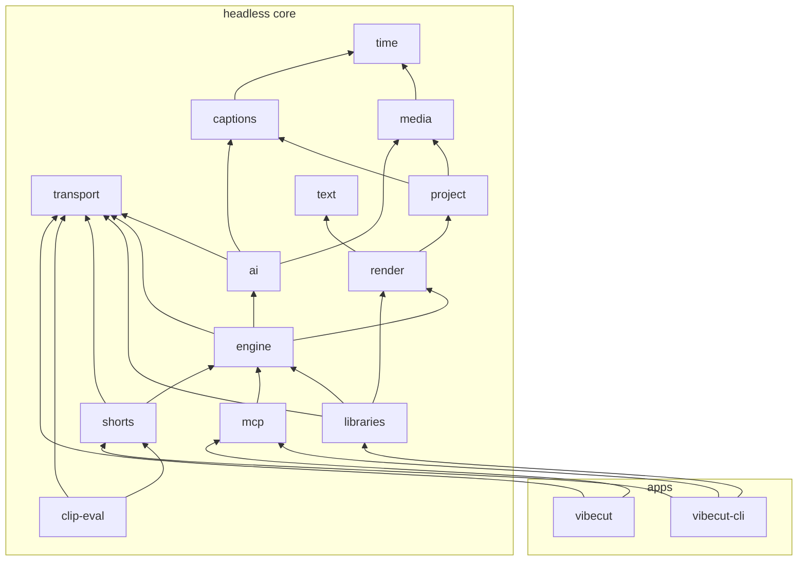
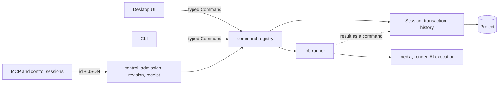

# Architecture

## Crate map

The core runs headless. Only `apps/*` may depend on UI, GPU, native window or dialog, audio-device or accessibility crates. `cargo xtask layers` enforces this table: an unlisted edge is forbidden. Update it in the same change that adds an edge.

| Package | Path | Owns | May depend on |
|---|---|---|---|
| time | crates/time | Ticks, rational rates, source ranges | - |
| transport | crates/transport | Bounded HTTPS requests, streaming downloads, redirect and retry-after rules | - |
| media | crates/media | Safe FFmpeg I/O: probe, demux/mux, decode/encode, hardware acceleration, conversion, speech and vision media preparation | time, testkit |
| testkit | crates/testkit | Dev-only synthetic media fixture builders, the timeline-item builder, generated-fixture paths and FFmpeg/FFprobe oracle discovery | media, project, time |
| project | crates/project | Scene/timeline/animation model, validation/evaluation, persistence, atomic file writes | time, media, captions, testkit |
| captions | crates/captions | Transcript and cue model, segmentation, mapping, language profiles, SRT/VTT/ASS import | time |
| text | crates/text | Unicode shaping and rasterization | - |
| render | crates/render | CPU compositor, caption overlay, audio mix, export execution | time, media, project, captions, text, testkit |
| ai | crates/ai | Provider interfaces, capabilities, consent and cost, AI adapters | time, media, captions, schemars, transport, testkit |
| engine | crates/engine | Session, commands, history, recovery scheduling, jobs, cache, adapter selection and per-shot analysis | time, media, project, captions, text, render, ai, transport, testkit |
| mcp | crates/mcp | MCP stdio protocol adapter, grants, inbox and OS-permissioned attach transport | engine, project, ai, render, time |
| libraries | crates/libraries | External project assets: user brand kits, font catalog with verified download/import cache, licensed sound search, saved library and previews, sticker flags and downloadable emoji and icon collections | engine, media, project, render, text, time, transport |
| shorts | crates/shorts | Clip suggestion, boundary snapping and accepted-short batch export | time, media, project, captions, render, ai, engine, transport, testkit |
| clip-eval | crates/clip-eval | Fixed labelled clip-pipeline evaluation harness, metrics and local reports | time, media, captions, ai, engine, shorts, transport |
| vibecut-cli | apps/vibecut-cli | Headless adapter: CLI arguments, typed exit codes, dispatch, control-session lifetime, project lease composition, export admission, bounded batch job files | engine, ai, media, project, render, time, shorts, libraries, mcp, testkit |
| vibecut | apps/vibecut | Desktop app: UI, playback, model-manager presentation, wgpu compositor, preferences, app controls and inspection; composes the MCP adapter into its composition root | time, engine, media, project, captions, text, render, ai, mcp, shorts, libraries, transport, testkit |

Only `media` links FFmpeg. Render's CPU compositor is the reference for preview and export; the app owns the optional wgpu adapter.

Tiers of the table, arrows pointing at the dependency. Edges implied by a path are omitted and `testkit` (dev-only) is left out; the table owns the edges.

## Contracts

Definitions: [glossary](../../GLOSSARY.md). Contract details live in these owners:

| Area | Contract owner |
|---|---|
| SourceAsset, codecs, probe, packet/frame timing | [media](../../crates/media/src/read/README.md) |
| Project, scenes, validation, persistence, writer lease | [project](../../crates/project/src/persistence/README.md#writer-lease-and-save-acknowledgement) |
| Video transitions | [project model/invariants](../../crates/project/src/visual/README.md#video-transitions), [engine edits](../../crates/engine/src/session/edit/README.md#video-transitions), [render evaluation](../../crates/render/src/scene/README.md#video-transitions) |
| Param and keyframes | [project animation](../../crates/project/src/animation/README.md#animated-parameters-and-retime) |
| SourceRange | [time](../../crates/time/README.md) |
| Transcript, Cue, CueStyle, EditMapping, LanguageProfile, FillerCandidate | [captions](../../crates/captions/README.md) |
| Managed catalog, copied-media publication and catalog history | [engine library](../../crates/engine/src/store/README.md#managed-project-library); project retains metadata/persistence |
| Session, registry, transactions, gestures, undo/redo | [engine](../../crates/engine/src/session/README.md#transactions-gestures-and-changes) |
| Control schemas, revisions, receipts, resync events | [engine control](../../crates/engine/src/control/README.md#control-admission-revisions-and-receipts) |
| Job runner, scheduling, retries, checkpoints, aggregate bytes | [engine jobs](../../crates/engine/src/runtime/README.md#background-jobs-and-byte-policy) |
| Default model, font and media cache locations | [engine runtime](../../crates/engine/src/runtime/README.md#default-cache-location) |
| Font catalog, system/bundled/Google fonts, download cache, `fonts.*` commands | [libraries fonts](../../crates/libraries/src/font_catalog/README.md#font-catalog); resolution and raster in [text](../../crates/text/src/fonts/README.md) |
| Row tasks and native conversion worker allowance | [engine kernel execution](../../crates/engine/src/runtime/README.md#render-kernel-execution) |
| Export execution | [render](../../crates/render/src/export/README.md#export-and-publication) |
| Preview screen/canvas conversion, selectable item geometry, rotated handles | [render viewport](../../crates/render/src/scene/README.md#preview-viewport-geometry) |
| Loudness measurement, gains and export admission | [render planner](../../crates/render/src/audio/README.md#audio-clock-and-headroom) / [engine job](../../crates/engine/src/analysis/README.md#loudness-normalization) |
| Clip naming, cue mapping, per-short cancel/retry | [shorts batch export](../../crates/shorts/src/batch_export/README.md) |
| Local model catalog, consent, integrity, transport / transfers, cache bundles / manager presentation | [ai catalog](../../crates/ai/src/foundation/models/README.md) / [transport](../../crates/transport/README.md) / [engine transfers](../../crates/engine/src/providers/README.md#local-model-transfers) / [app manager](../../apps/vibecut/src/editor/dialogs/models/README.md) |
| Clip boundary snapping / speech groups / speech windows and energy | [shorts](../../crates/shorts/src/boundaries/README.md) / [captions](../../crates/captions/src/segment/README.md#source-cut-units) / [media windows](../../crates/media/src/audio/README.md#speech-windows) and [energy](../../crates/media/src/audio/README.md#speech-energy-windows) |
| Shot analysis and complete artifact caching | [engine analysis](../../crates/engine/src/analysis/shot_analysis/README.md#per-shot-analysis) |
| Vision preparation / inference, face embeddings and shape-plan cache | [media](../../crates/media/src/vision/README.md) / [ai detectors](../../crates/ai/src/vision/README.md) |
| Provider capabilities, consent, cost / text timing / isolated Gipformer | [ai contracts and consent](../../crates/ai/src/foundation/contracts/README.md#consent-and-cost) / [recognition](../../crates/ai/src/recognition/assembly/README.md) / [local runner](../../crates/ai/src/recognition/gipformer/README.md) |
| Sound search, saved local sounds, preview cache and attribution | [libraries sounds](../../crates/libraries/src/sound_library/README.md#sound-library) |
| Translation windows and response validation / selection, retry, edit protection | [ai translation](../../crates/ai/src/text/translation/README.md) / [engine application](../../crates/engine/src/transcript/README.md#translation-selection-and-application) |
| Chapter document, prompt and validation / sidecar publication | [ai chapters](../../crates/ai/src/text/chapters/README.md) / [engine artifacts](../../crates/engine/src/artifacts/README.md#chapter-sidecars) |
| Filler classification input, exact-ID validation and shared text-model transport | [ai fillers](../../crates/ai/src/text/fillers/README.md) / [engine job](../../crates/engine/src/analysis/README.md#filler-classification) |
| SpeechSynthesizer capabilities, requests, consent, PCM validation | [ai speech](../../crates/ai/src/speech/README.md) |

Every project mutation goes through the engine command registry; UI, CLI and MCP only translate their transport into it. In-process callers pass a typed `Command`; a command id with JSON parameters exists only on the control wire. A workflow that runs as a job is a registry command, so every transport can start it. Engine wraps media, render and AI execution with progress and cancellation. Per-project view state lives in the project's [metadata sidecar](../../crates/project/src/persistence/README.md#optional-project-metadata), outside undo. Recovery: [engine](../../crates/engine/src/store/recovery_workflow/README.md#session-recovery-and-save-acknowledgement).

## Languages

Languages are BCP 47 tags (`vi`, `en`, `zh-Hans`, `zh-Hant`), each with one [captions profile](../../crates/captions/src/language/README.md); unknown tags use the generic profile. Adding a language adds a profile, fonts and optionally a UI catalog.

## Media and time

Codecs, seeking and timestamps: [media](../../crates/media/src/read/README.md). Time rules: [standards](standards.md#time-and-text).
