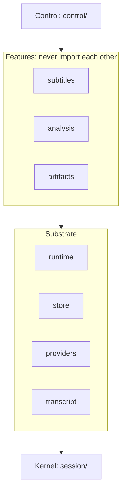
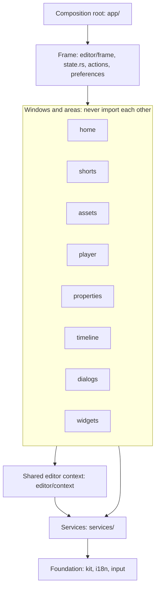
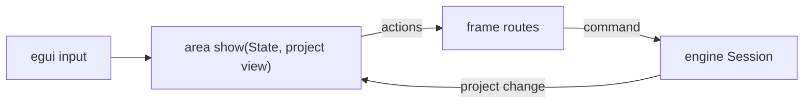

# Structure

What is inside a crate or app and which way imports point. Crates and their contracts: [architecture](architecture.md). File length is never a rule.

## Rules

1. One responsibility per module, stated in its `//!` line in one sentence without "and". Name it after the concept (`timeline`, `recovery`); never `utils`, `common`, `manager`, `helpers`, `misc`, `core`, `types`.
2. A folder holds one layer or one feature. Children with a shared prefix (`clip_*`) or two kinds become a folder. More than 12 direct children means regroup.
3. Layout is `foo.rs` plus `foo/`, never `mod.rs`. `foo.rs` declares private children and re-exports only the interface; nothing imports another module's internals. Visibility: private, then `pub(super)`, `pub(crate)`, `pub` only for the crate interface. Fields private by default.
4. Imports point down the layer table. Features never import each other; shared logic moves to the lowest layer both can use.
5. Tests call the module's interface. Needing internals means the boundary is wrong.
6. New code goes, in order: into the existing owner; a new module in the owning folder; a new folder when a second responsibility appears; a new crate only with a second consumer or an independent seam ([crate map](architecture.md#crate-map)).
7. Add a trait or registry only when two implementations already vary across it.
8. Review asks: is the code in its owner, did an interface grow, does each module pass rule 1, did an import cross a layer or feature. Any "no" is `changes`.

## Naming

- Modules and types use [GLOSSARY](../../GLOSSARY.md) terms, singular. A new concept enters the glossary first.
- Providers are `<family>/<operation>` (`providers/anthropic/translate`).
- Test helpers live in `tests/it/support.rs` and `tests/it/support/`; helpers shared across crates live in `testkit`. Tests are named by behaviour; app test files have no `_ui` suffix. A test module covers one command family or one workflow (`tests/it/session/ripple.rs`); a new test goes into its family's module, and no module collects unrelated families.

## Engine (`crates/engine/src`)

Lowest first; imports go down only.

| Layer | Folders |
|---|---|
| Kernel | `session/`: session, command registry, history, control wire contract; the only mutation path |
| Substrate | `runtime/` (jobs, budget, cache, publication), `store/` (library, recovery), `providers/` (consent, models), `transcript/` (ASR and cue translation) |
| Features | `subtitles/`, `analysis/`, `artifacts/` |
| Control | `control/`: admission and dispatch; may call every feature |

Features register commands through the registry; the kernel never names a feature. Each layer declares the errors it raises and states the wire code of each variant where it is declared; a higher layer wraps a lower error, and no layer names an error of a layer or crate above it. The layer table is enforced from `xtask/modules.toml`.

## Libraries (`crates/libraries/src`)

`brand_kit/` is the user's brand kit store, outside projects. `font_catalog/` and `sound_library/` are independent features exposed as `fonts` and `sounds`; each owns its local cache and admission limits and shares the [`transport`](../../crates/transport/README.md) crate's bounded HTTPS client. Imports point down to `engine`, `transport` and the domain crates.

## Desktop app (`apps/vibecut/src`)

Lowest first; imports go down only, and a window never names another window.

| Layer | Holds |
|---|---|
| Foundation | `kit/` (tokens, icons, widgets, appearance), `i18n/`, `input/`; no engine knowledge |
| Services | `services/`: playback, preview, crop, AI task progress, the editor session with autosave, `gpu/` (the wgpu effects adapter, capture) |
| Shared editor context | `editor/context/`: the read context, the one write context, thumbnails, the one-selected-item read and the clip display contract every editor area names |
| Windows and areas | `home/`, `shorts/`, editor areas (`panels/` with assets, player and properties, `captions/`, `dialogs/`, `timeline/`, `widgets.rs`) |
| Frame | `editor/frame/`, the `Editor` record (`editor/state.rs`), `actions/`, `preferences/` |
| Composition root | `app/`: wiring, window registry, control attach |

The crate root holds exactly `kit/`, `i18n/`, `input/`, `services/`, `home/`, `shorts/`, `editor/`, `actions/`, `preferences/`, `app/`, `lib.rs` and `main.rs`; a new shared module goes into `services/` or `kit/`, never beside them. The engine `Session` owns the item selection; areas read it and never keep a copy.

Home and Shorts share one window interface: `State`, `Context`, `Action` and `show(&mut State, Context, &mut Ui) -> Vec<Action>`. `app/` builds the `Context`, draws the viewport and carries each returned `Action` out; a window never names `app/`. Stores and the model service reach an editor only through `app/lending.rs`.

An editor area exposes its `State` and a `show(...)` returning actions; areas never import each other, the frame routes their actions. Captions is a tab inside `assets/`. Inside `editor/`, `xtask/modules.toml` carries a folder table: `context/` is the lowest layer, the areas above it import nothing from each other, and `frame/` and the `Editor` record route above them; each new editor module adds its own line there.

### Editor area ports

An area never names `Editor`. The frame lends it a `Port` (`editor/context/port.rs`): the open session, a read snapshot (locale, theme, playhead, byte budget, preferences, clip rectangles, the frame's `insertion_available` and caption-bank answers) and the notes the area leaves for the frame (error line, toast, preview resync, selection reset, preference write, widget record, cross-area `Request`). The frame applies the notes after the area returns. An area handles its own actions with `apply(&mut State, &mut Port, ...)`; the frame routes only `Request`s, which cross areas. `cargo xtask modules` rule 5 (`frame-type`) fails any file under `context/` or an area that names `Editor`; `xtask/modules-baseline.txt` lists the files still waiting for their slice and each slice deletes its entries.

Slice plan, one line per area: the state that moves, the port it uses and the pass-through it deletes.

| Slice | Area | State that moves | Port | Pass-through deleted |
|---|---|---|---|---|
| 1 (done) | assets | Music (`music`, `music_media_dir`) moves from `Editor` to `assets::State` beside sounds; captions mount inside the area | `Port`: session, read snapshot, notes | `frame/assets.rs` (35-variant action map, clip-export forwards), the `Editor` forwards for insert, delete, tab and import, `Editor::{tick_music, add_effect_to_item}`, every `desk.editor()` in `panels/assets` |
| 2 (done) | properties | The colour-picker open and LUT pick entry points move from `Editor` onto `properties::State`; `selection_scopes` stays frame-owned and the area only asks the desk to leave the removed transition's scope | `Desk::lend_properties` lends the state apart from the editor; the area reads `edit_ready`, `details` and `transition` from the desk's `View` (the area moves onto `Port` with slice 5, which deletes `Desk`) | the 10 `desk.editor()` sites in `workflow`, `commands`, `fonts` and `transition`; the `Editor::{open_color_picker, lut_picked_file, pick_key_color}` bodies |
| 3 (done) | player | `key_color_pick` is armed by a `Request::ArmKeyColor` the frame drains into `player::State`; the crop session reads through the port | `Port`; crop `open` and `show` take it, `available` and `target` read the session it lends, none takes `&mut Editor` | `Desk::arm_key_color_pick`, the four `Editor`-taking functions in `panels/player/crop.rs` (its baseline entry) |
| 4 (done) | timeline | `replace_request` moves into `timeline::State`; scenes and toolbar already return actions | `Port`; `route_timeline` and `track_command` become `timeline::apply` | the `with_timeline` widget copy loop, the `frame/input/selection.rs` forwards, `Editor::request_replace_media` (now a `Request`) |
| 5 | dialogs, then context | `lifecycle_action` writes (export save, voice-over) become requests; the preferences shortcut import and export take the port | `Port`; each dialog applies its own actions | the 18 non-test `.editor()` sites, `Editor`-taking `shortcuts::{import, export}` (its baseline entry); then `Desk`, `Desk::editor` and the `context.rs` and `context/bench.rs` baseline entries |

## CLI (`apps/vibecut-cli/src`)

`args/`, `output/`, `session/`, `mcp/`, and `commands/` with one module per command exposing `run(context, args)`. `lib.rs` only wires them.

## Modules and crates

Start as a folder; promote to a crate when it gains a second consumer, an independent seam, heavy dependencies or keeps breaking its import direction. Next candidates: `subtitles` and `analysis` above `engine`, and the edit algebra out of `session/edit`. Why: [ADR 0004](../adr/0004-module-structure.md).

## Enforcement

`cargo xtask modules` (in `checks`) enforces rules 1–4 and the `frame-type` rule: `//!` lines, no `mod.rs`, banned names, folder width, the layers in `xtask/modules.toml` and the `[[crate.folder.forbid]]` type names (including `[[crate.folder]]` tables for areas inside a module). `cargo xtask docs` checks that every crate README maps its folder modules and every folder module has a README. `xtask/modules-baseline.txt` lists known violations and may only shrink.
